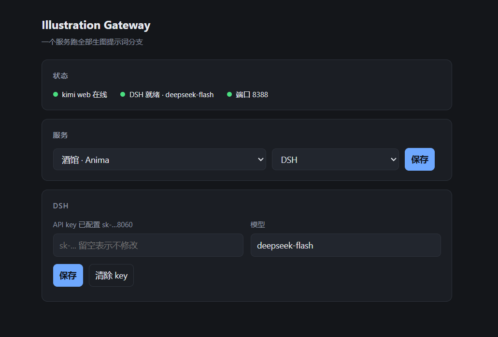
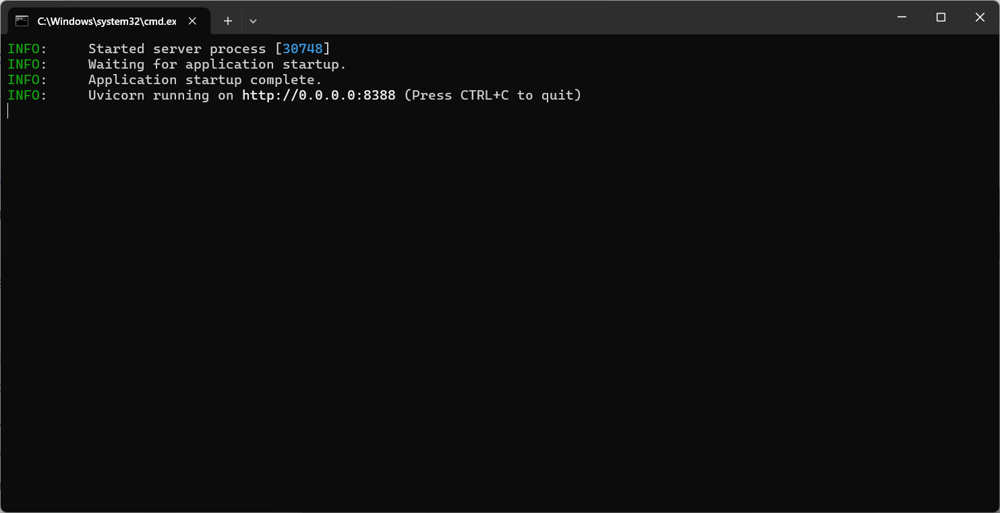
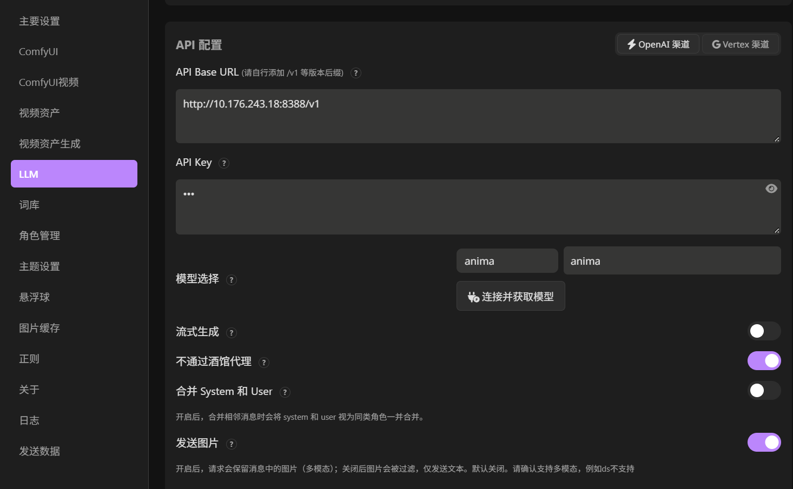
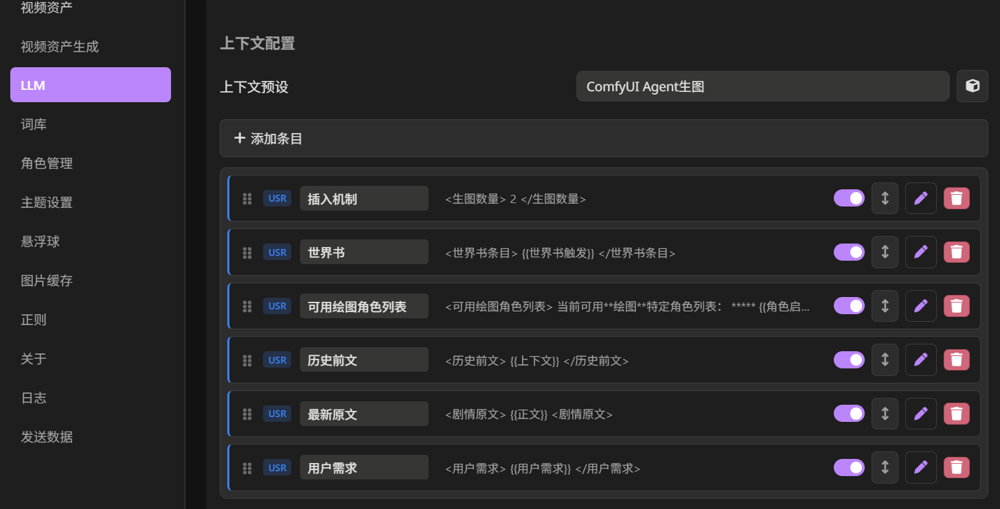
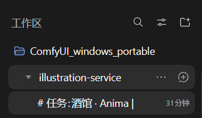
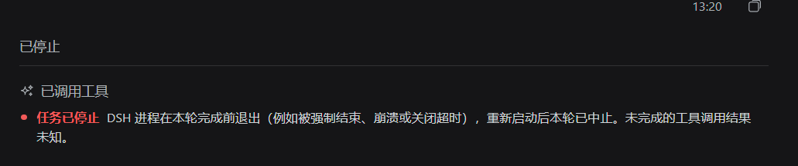
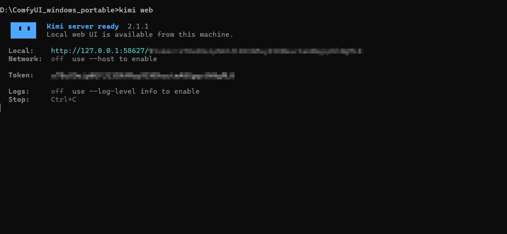
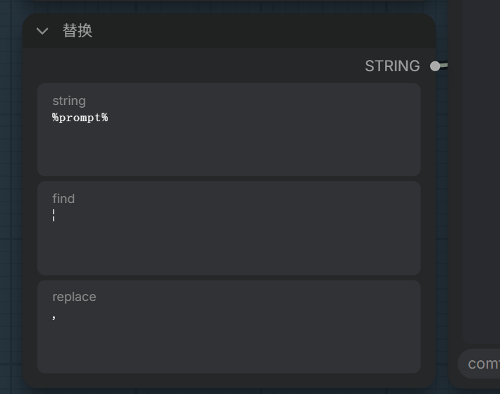

# illustration-service

一个用于将生图提示词Agent过程包装成大模型API服务的**中间层**。

它把自己伪装成一个 OpenAI 接口。前端发送LLM请求时，本服务会将信息交给一个本地 agent，由 agent 按固定的方法论写出生图提示词，再经过硬校验，最后按约定的格式返回。前端拿到结果，自己丢给 ComfyUI 出图。

目前服务包括四种模式，对应不同的生图模型或场景；agent 后端可以在 DSH 与 KimiCode 之间切换。

本仓库的核心是两部分：一个把 Agent 过程包装成 OpenAI 接口的**中间层服务**（`facade/`），和一组真正干活的**生图提示词 SKILL**（`.agents/skills/`）。服务负责路由、素材提取、校验和返回格式，SKILL 负责怎么把一段剧情写成提示词；换插件或换模型，通常只要换 SKILL。

本服务主要服务于酒馆插件智绘姬：<https://github.com/damoshen123/st-chatu8>，对于凡人修仙传独立前端，已经有较长时间没有做匹配，需要你在双边自行调整许多内容才可以正常使用，有兴趣者可以自行修改，此后的内容说明都以酒馆为基准。

本仓库**不附带**工作流文件，因为每个人的模型、VAE、LoRA、采样设置都不一样。这部分内容在智绘姬插件的教程中已经有详细的解释，这里不在赘述。

 

---

## 一次请求发生了什么

以酒馆为例，假设你在正文里触发了生图：

1. 酒馆按照配置的预设将信息渲染成一段文本，里面带 `<剧情原文>`、`<用户需求>`、`<生图数量>`、`<可用绘图角色列表>`、`<历史前文>` 这些标签，POST 到 `http://<你的IP>:8388/anima/v1/chat/completions`。
2. 网关看路径里的 `anima`，选中动画分支；把请求体里的标签逐段切出来，拼成一份「素材」。
3. 素材丢给 agent（DSH 或 KimiCode），并要求它先加载对应的技能文档（`.agents/skills/story-illustrator-anima/SKILL.md`）。技能里写清楚了决策树、槽位顺序、标签库怎么查、输出长什么样。
4. agent 回一段 `<images><image>…</image></images>`。
5. 网关把它解析成结构化块，逐项校验：块数对不对、`<regex>` 是不是正文原句、`<size>` 合不合法、有没有禁用词、布局框有没有出界。
6. 校验不过就带着错误清单让它重写一次（`MAX_RETRIES`）。还不过就返回 502，并在日志里写清楚原因。
7. 通过后渲染成插件认识的样子返回（普通 JSON 或 SSE 流）。
8. 插件用 `%prompt%` / `%width%` / `%height%` / `%seed%` 做字符串替换，把你自己的 ComfyUI 工作流填好，提交出图。

这套流程并不绑定智绘姬，也不绑定具体的生图模型。凡是「把正文交给 LLM 写提示词、再填进工作流出图」的插件，只要把两端的规范对齐就能接进来：进去的一侧是请求里**用什么标签装素材**，出来的一侧是**返回什么格式插件才解析得了**。现在的四种模式，就是这组规范的四份实例。

---

## 四种模式

| 模式 | 给谁用 | `<prompts>` 格式 |
|---|---|---|
| `anima` | 酒馆 · Anima 工作流 | Danbooru tag 串混合英文自然语言 |
| `moss` | 酒馆 · MOSS-Image（caption） | 英文单段散文 |
| `layout` | 酒馆 · MOSS-Image（layout） | 布局 JSON |
| `frz` | 凡人修仙传独立前端 · Anima 工作流 | Danbooru tag 串 |

每条模式对应一份同名技能：`.agents/skills/story-illustrator-<模式名>/`。

---

## 快速开始

**1. 确认你已经启动了 DSH 或Kimicode**

**2. 启动服务**

```bat
run_gateway.bat
```

默认监听 `0.0.0.0:8388`。浏览器打开 `http://127.0.0.1:8388/` 是管理页。

**3. 在管理页填两样**

- **DSH 的 API key**（`sk-…`）和模型名（默认 `deepseek-flash`）
- **服务 / harness** 两个下拉：前者决定不带前缀的请求走哪条分支，后者决定这条分支用哪个 agent

**4. 在插件中指向本服务**

- 生图后端地址填 `http://<127.0.0.1 或 你的局域网IP>:8388/v1`，本服务将自己包装成了OpenAI url，你可以直接点击 `连接并获取模型` 之后从`模型选择`中选择工作模式，如下图
- **API Key 随便输**，本服务不校验它，只要不是空的就行
- 在智绘姬中导入你对应模型的工作流，此部分内容在智绘姬插件教程中已有详尽说明，此处不赘述



---

## 导入上下文预设

智绘姬会把你在「LLM → 上下文预设」里配的条目渲染成一段文本发给本服务，本服务靠**标签名**把素材一段段切出来。标签对不上，agent 拿到的就是一堆没有区分的正文。

仓库里带了预设文件：[presets/正文生图LLM预设.json](presets/正文生图LLM预设.json)

1. 智绘姬 → `LLM` → 上下文预设 → 导入，选中导入后的 `ComfyUI Agent生图`
2. 确认下面六条都在，并且都处于开启状态



| 标签 | 作用 | 备注 |
|---|---|---|
| `<剧情原文>` | 要画的那段正文 | 缺失报错「无法从请求中提取素材」 |
| `<用户需求>` | 你这次额外加的要求 | 可选，不影响出图 |
| `<生图数量>` | 这次画几张 | 缺省按 2 张（超过 6 张也按 2 张） |
| `<可用绘图角色列表>` | 保留了对智绘姬的角色管理功能的适配 | 无影响，你可以通过世界书条目维护角色形象 |
| `<历史前文>` + `<世界书条目>` | 前后文与设定 |-|

---

## Harness：

`facade/runtimes/` 下有两个实现，**推荐 DSH**。

### DSH（推荐）

每次请求起一个 `dsh --profile headless` 进程，stdout 就是最终文本，cwd 指向本仓库。

- **只需要一个 API key**，账号登录态在命令行里本来就不可用（会报 `ACCOUNT_SIGN_IN_REQUIRED`），填 key 即可。
- key 取用顺序：管理页保存的 `instance/settings.json` → 环境变量 `DEEPSEEK_API_KEY`。
- **技能和 MCP 与 KimiCode 共用同一份**：技能在 `.agents/skills/`（两边都原生扫描这个目录），MCP 清单在 `.kimi-code/mcp.json`。运行时生成的 `instance/dsh-agent.patch.yml` 只做两件事：钉模型、把 `mcp.json` 里的 stdio server 插成 `dsh-mcp-client` 条目。
- **会话**：每次运行都会落成一个正常会话。在 DSH Desktop 中会存在一个 `未分组` 工作区，能看到思考、读了哪个 `rules/`、grep 了什么、最终输出。任务首行带 `# 任务:<模式> | <剧情开头>`，需要注意的是，DSH Desktop的会话无法实时渲染到窗口，只有界面刷新时才会出现会话，最终，这个会话会被放进`illustration service`工作区



此外，在任务完成之前，你会看见




这并不是任务真的停止了，同样是由于会话无法实时渲染导致的。


### KimiCode（更复杂，需要你知道自己在改什么）

`runtime` 走本机的 `kimi web` 常驻服务（默认 `127.0.0.1:58627`），按技能名激活、每请求一个会话。

**需要修改的内容**：一堆个人设置：

- `KIMI_MODEL` 默认是 `Deepseek/deepseek-flash`，这是作者 `~/.kimi-code/config.toml` 里的模型别名。你的配置里没有这个别名就用不了——按照你自己 `config.toml` 里的模型修改，或者留空走全局默认模型。
- 需要先有 `kimi web` 在跑，且 token 在 `~/.kimi-code/server.token`（或用 `KIMI_TOKEN` 给）。

*<p align="center"> 你可以在终端中查看kimi token </p>*

所以：**只想开箱即用，就用 DSH。** 想用 KimiCode，请自己改好 `facade/config.py` 里的 `KIMI_MODEL` 和你的 `config.toml`，或者直接把这段交给 AI 让它帮你配置好。

---

## 输出契约

### 凡人前端（`frz`）

请求体里是「在场角色完整外观资料 / 场景信息 / 当前正文 / 当前正文生图模式 / 固定输出 N 个」。返回：

```
<image>
<anchor>正文原句</anchor>
<prompt>英文 tag</prompt>
</image>
```

`anchor` 必须逐字命中正文、8–30 字、按剧情顺序。

### 酒馆三条分支（`anima` / `moss` / `layout`）

```
<images>
<image>
<regex>剧情原句，5-60 字，单行</regex>
<title_styled>标题，5-15 字中文</title_styled>
<Tag_think>60-100 字半文言</Tag_think>
<size>1024x1536</size>
<prompts>…</prompts>
</image>
</images>
```

- `anima` 的 `<prompts>` 是 tag 串。
- `moss` 的 `<prompts>` 是英文单段散文（MOSS 官方 Prompt Enhancer 规格：80–200 词，禁质量词、禁权重语法、禁下划线 tag；画面里的文字用原语言引用）。
- `layout` 的 `<prompts>` 是MOSS官方给出的一种实验性提示词写法，使用JSON格式进行画面的布局控制（参考`https://github.com/OpenMOSS/MOSS-Image/blob/main/USERGUIDE_ZH.md`），如果使用这种模式，你需要对你的工作流进行额外调整，具体见下。

### layout 的逗号转义

智绘姬插件会把提示词送进 `deduplicateTags`，它按逗号切分去重——直接送布局 JSON 会被切碎：

```
DROPPED: ['{"label":"text"', '-12', '388]}]']
JSON VALID: NO -> Expecting ',' delimiter
```

所以网关把编译后 JSON 里的每个 `,` 换成了 `¦`（U+00A6）。整段没有逗号，插件就只看到一个分段，原样保留。

**这意味着你的 layout 工作流里必须有一个把 `¦` 换回 `,` 的节点**（ComfyUI 核心的 `StringReplace`，find `¦`，replace `,`），接在正面提示词前面，如下图所示。caption 分支不需要。



---

## 配置

| 环境变量 | 默认 | 说明 |
|---|---|---|
| `GATEWAY_PORT` | `8388` | 监听端口 |
| `DEFAULT_MODE` | `anima` | 不带前缀时走哪条分支（管理页保存的值优先） |
| `AGENT_BACKEND` | `dsh` | 全局后端；`AGENT_BACKEND_<MODE>` 可按模式覆盖 |
| `MAX_RETRIES` | `1` | 校验失败后的重写次数 |
| `AGENT_TIMEOUT` | `300` | 等 KimiCode 回合结束的秒数 |
| `DEEPSEEK_API_KEY` | — | DSH 的兜底 key |
| `ALLOW_REMOTE_ADMIN` | `0` | 设 `1` 才允许局域网访问管理页 |
| `DSH_ROOT` | `D:\DeepSeek Harness` | DSH 安装目录 |
| `DSH_AGENT_MODEL` | `deepseek-flash` | DSH 模型 |
| `DSH_TIMEOUT` | `420` | 单次 DSH 超时 |

管理页保存的东西写在 `instance/settings.json`，优先级高于环境变量。

> 别用 `DSH_PROFILE` 这个变量名——桌面端自己用它，会把 `desktop` profile 带进子进程。运行时也会主动剥掉 `DSH_PROFILE` / `DSH_SESSION_ID` / `DSH_WEB_URL` 等。

---

## 敏感信息

- 管理接口返回的 key 永远是打码的（`sk-1…abcd`），前端拿不到明文。
- 管理页和管理接口默认**只允许本机**访问，局域网只能调生成接口。

---

## 技能与 MCP

- 技能只有一份：`.agents/skills/<name>/SKILL.md`（外加 `rules/`、`tags/`）。KimiCode 按名字激活，DSH 从同一个目录自动发现。改技能只动这里。
- `.kimi-code/mcp.json` 注册了 Booru-Pictag-Get（搜索 danbooru 标签），技能铁律限定**只用于同人/IP 角色**，每个角色最多 2 次，你可以根据自己的需要修改。DSH 运行时把它翻成 `dsh-mcp-client` 条目，工具名以 `mcp__booru-pictag-get__*` 出现。
- 这个 MCP 的可执行文件路径是作者自己机器上的（`.venv/Scripts/booru-pictag-get-mcp.exe`），**请让你的AI帮你配置好**。文件不存在时 DSH 照常跑，只是没有那几个工具。

---

## 参与贡献

### 接入其他生图插件

本服务不绑定插件本身，只依赖两端的文本规范，所以更换插件只需要对齐两处：

| 环节 | 对齐内容 | 改动位置 |
|---|---|---|
| 请求 | 正文、需求、张数、角色、历史各自的标签或字段 | `facade/st_extractor.py`（标签式）或 `facade/extractor.py`（字段式） |
| 返回 | 插件解析所用的格式：正则、JSON 或 SSE 流 | `facade/sse.py` 的四种响应 |

标签式接口可直接复用：插件只要把素材写入 `<剧情原文>`、`<用户需求>`、`<生图数量>` 等标签，现有的提取器与 SKILL 无需修改。

### 新增一种模式

一种模式对应一条「提取 → SKILL → 解析 → 校验 → 渲染」链路，在 `facade/modes.py` 的 `MODES` 中注册，管理页、URL 路由与 `/v1/models` 均从中读取。

换生图模型即为新增一条模式：SKILL 改写法，校验器改规则，路由、重试与返回格式沿用现有实现。

1. **确定输出契约**。定义 `<image>` 的子标签与 `<prompts>` 的格式（tag 串、散文或布局 JSON）。契约确定后，SKILL、校验器与工作流按同一份契约实现。
2. **编写 SKILL**。在 `.agents/skills/story-illustrator-<模式名>/` 下创建 `SKILL.md`：frontmatter 包含与目录同名的 kebab-case `name` 与一行 `description`；正文包含铁律、决策树、槽位顺序、标签库检索方式与输出契约。素材规模较大时拆到 `rules/`、`tags/`，由 agent 按需读取。
3. **实现校验器**。三个函数：`parse_blocks()` 将回复切分为结构块，`validate()` 返回错误列表（空列表表示通过），`render()` 生成插件所需文本。校验结果用于驱动重试，未通过时将错误列表回传 agent。
4. **注册模式**。在 `MODES` 中新增 `Mode(key, title, skill, extract, build_args, parse, validate, render)`。`extract` 与 `build_args` 可复用，三条酒馆分支共用同一套提取逻辑。
5. **补充自测**。参照 `facade/st_selftest.py` 编写负样本（缺标签、数量越界、格式错误），避免每次依赖真实模型。

模式 key 同时作为 URL 前缀与模型名（`/<key>/v1/...`、`/v1/models` 中的 id）。若需兼容旧调用，在 `MODES` 下方的 `ALIASES` 中保留映射。

### 使用其他 Harness

1. **会话调用**。各 agent 的会话启动方式不同，由 `run(args, mode) -> str` 统一适配：按其规范构造命令或请求（子进程或 HTTP），传入素材，返回最终文本，失败抛出 `AgentError`。可对照两个现有实现：`dsh.py` 启动 `dsh --profile headless` 子进程并通过 stdin 传入任务；`kimi.py` 调用 `kimi web` 的 HTTP 接口并按技能名激活。

2. **注册**。新增 `facade/runtimes/<name>.py`，在 `facade/runtimes/__init__.py` 的 `BACKENDS` 中注册。管理页的 harness 下拉、`backend_for()` 的选择、按模式指定后端（`AGENT_BACKEND_<MODE>` 或设置文件中的 `backends`）均自动读取，无需改动其他位置。

3. **SKILL 与 MCP**。技能位于 `.agents/skills/<name>/SKILL.md`：DSH 原生扫描该目录，其他 agent 需按其规范将技能根指向该路径。MCP 清单位于 `.kimi-code/mcp.json`：kimi 直接读取，DSH 由运行时代码生成 `dsh-mcp-client` 条目；新后端在生成自身配置时写入等价的 MCP 定义。

### 提交之前

提交前执行两个离线自测，无需模型与网络：

```bat
..\python_embeded\python.exe -m facade.st_selftest
..\python_embeded\python.exe -m facade.moss_selftest
```

修改 `facade/` 下的 Python 后需重启 `run_gateway.bat`，否则进程仍运行旧代码。仓库中不得包含 `instance/`、`logs/` 及任何 API key。

---

## 目录结构

```
facade/
  gateway.py      唯一入口：路由、管理页、OpenAI 兼容响应、重试
  modes.py        模式注册表：一条分支 = 提取器 + 技能 + 解析 + 校验 + 渲染
  config.py       路径与所有可覆盖的默认值
  settings.py     instance/settings.json 的读写（key 在这里）
  ui.py           管理页 HTML
  extractor.py    凡人前端的素材提取 + 参数拼装
  st_extractor.py 酒馆的标签提取（<剧情原文> 等）
  validators…     frz / anima / moss / layout 各自的解析与校验
  moss_layout.py  布局草稿 → 官方编译格式（含 ¦ 转义）
  sse.py          OpenAI / DeepSeek 两种响应格式（流式与非流式）
  dsh_workspace.py DSH 会话补登记
  runtimes/       kimi.py / dsh.py / base.py
.agents/skills/   技能文档（agent 的方法论都在这里）
.kimi-code/       MCP 清单
presets/          智绘姬的上下文预设（导入用）
docs/img/         README 里的截图
instance/         本地设置（不入库）
```
